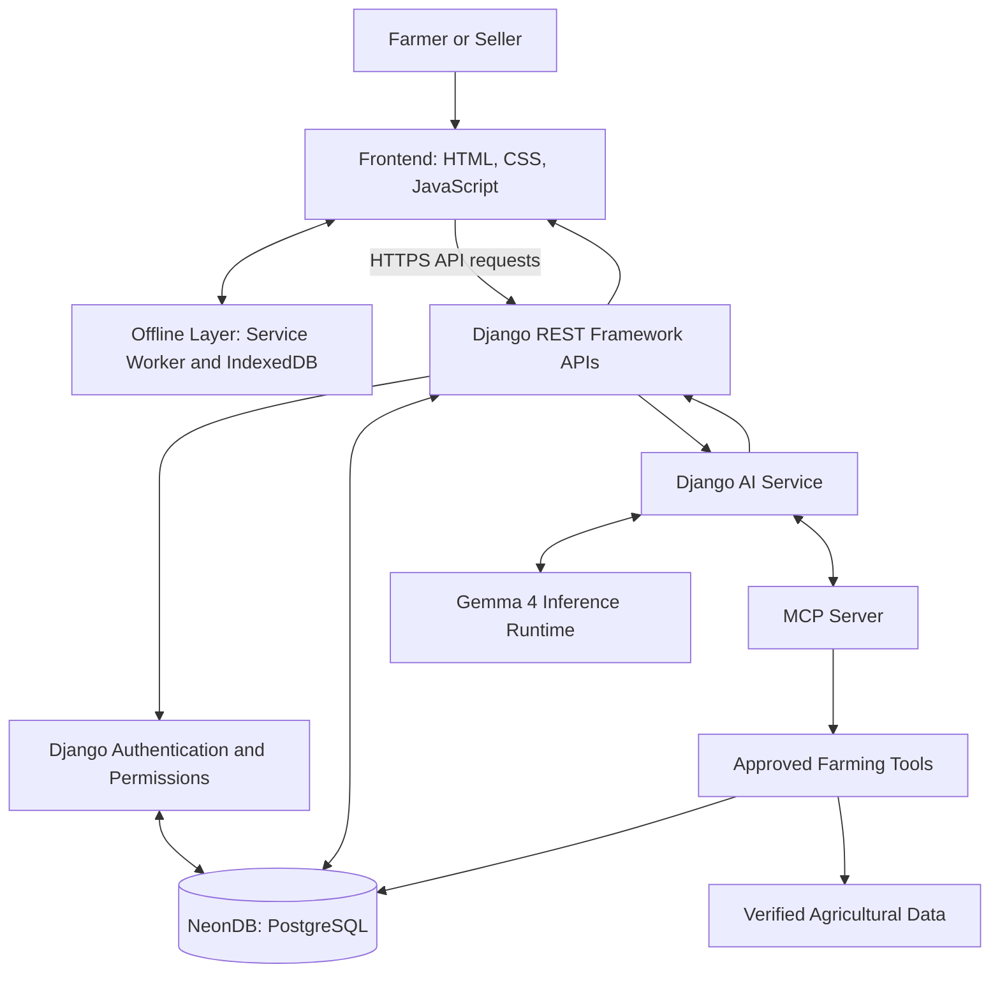
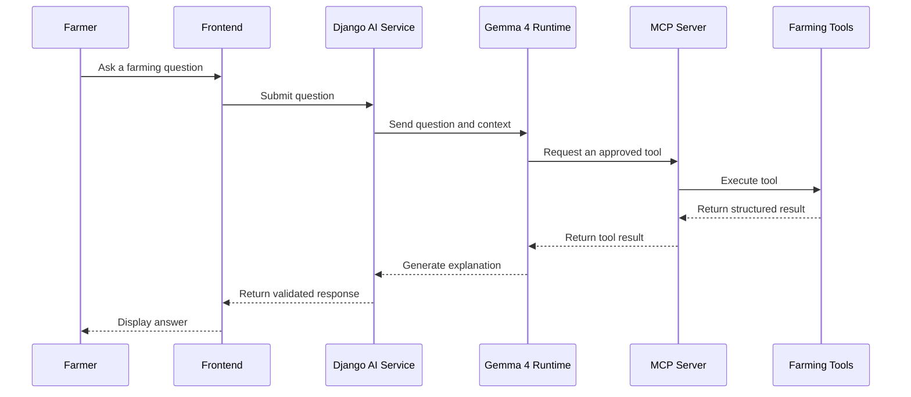

# Architecture.md — KisanSaathi

## 1. Project Overview

KisanSaathi is an AI-powered, farmer-focused website designed to help farmers make better agricultural decisions.

The platform provides:
- Harvesting and crop-decay guidance.
- Irrigation, fertilizer and manure calculators.
- Buyer price comparison.
- Government schemes and agricultural loan information.
- A seller interface for creating purchase requests.
- An AI chatbot powered by Gemma 4.
- Voice commands, language selection and dark/light mode.
- Offline access to essential farming information.

The architecture is designed to be modular, maintainable, secure and suitable for a hackathon MVP.

---

## 2. Technology Stack

| Layer | Technology | Responsibility |
|---|---|---|
| Frontend | HTML5 | Page structure and content |
| Styling | CSS3 | Layout, responsive design and themes |
| Frontend logic | JavaScript | Interactions, API requests and UI updates |
| Backend | Python + Django | Business logic and authentication |
| API layer | Django REST Framework | Communication between frontend and backend |
| Database | NeonDB (PostgreSQL) | Persistent application data |
| ORM | Django ORM | Database queries and model management |
| AI model | Gemma 4 | Natural-language understanding and farming explanations |
| AI tool integration | MCP | Exposing approved farming tools to the AI |
| Authentication | Django authentication | Registration, login, sessions and permissions |
| Offline support | Service Worker + IndexedDB | Cached pages, saved guides and local data |

---

## 3. High-Level Architecture



### Architecture Explanation

1. **Frontend:** Displays the website and collects user input.
2. **Offline layer:** Stores essential pages and selected farming information for offline use.
3. **Django backend:** Processes requests, validates inputs and applies business rules.
4. **NeonDB:** Stores user accounts, crop information, buyer offers, seller requests and other application records.
5. **Gemma 4:** Generates explanations and interprets users' farming questions.
6. **MCP server:** Gives the AI controlled access to approved tools and structured information.
7. **Agricultural data layer:** Provides verified references and available farming information.

The frontend should never connect directly to NeonDB using database credentials. Database access must happen through the backend.

---

## 4. Frontend Architecture

### Technologies
- HTML5
- CSS3
- JavaScript
- Fetch API for backend communication
- Service Worker for caching
- IndexedDB for local storage

### Suggested Folder Structure

```text
frontend/
├── index.html
├── login.html
├── farmer-dashboard.html
├── seller-dashboard.html
├── profile.html
├── css/
│   ├── style.css
│   ├── auth.css
│   ├── dashboard.css
│   └── themes.css
├── js/
│   ├── api.js
│   ├── auth.js
│   ├── farmer.js
│   ├── seller.js
│   ├── chatbot.js
│   ├── voice.js
│   ├── settings.js
│   └── offline.js
├── assets/
│   ├── images/
│   └── icons/
├── manifest.json
└── service-worker.js
```

### Frontend Responsibilities

- Render the welcome page and login/signup screens.
- Display the correct dashboard according to the authenticated user's role.
- Submit calculator inputs to the backend where appropriate.
- Display buyer offers and seller purchase requests.
- Send chatbot questions to the Django API.
- Support language preferences and dark/light mode.
- Provide accessible forms, loading indicators and error messages.
- Cache essential resources and saved farming guides.

### Frontend Rules

- Never store database passwords or AI service secrets in JavaScript.
- Never trust a role supplied by the browser without backend verification.
- Clearly label demo data.
- Keep essential navigation usable on mobile devices.

---

## 5. Backend Architecture

### Technologies
- Python
- Django
- Django REST Framework
- Django ORM

### Suggested Folder Structure

```text
backend/
├── manage.py
├── config/
│   ├── settings.py
│   ├── urls.py
│   └── wsgi.py
├── apps/
│   ├── accounts/
│   ├── crops/
│   ├── calculators/
│   ├── marketplace/
│   ├── schemes/
│   └── assistant/
├── requirements.txt
└── .env.example
```

### Backend Responsibilities

**Accounts**
- Registration and login.
- Session management.
- User profiles.
- Farmer/seller role permissions.

**Crops**
- Crop guidance.
- Harvesting information.
- Crop-decay observations.
- Saved crop resources.

**Calculators**
- Irrigation estimates.
- Fertilizer quantity calculations.
- Manure calculations.
- Unit conversions and validation.

**Marketplace**
- Buyer offers.
- Seller purchase requests.
- Offer sorting and comparison.
- Demo listings for the prototype.

**Schemes**
- Scheme information.
- Eligibility guidance.
- Official source references.
- Last-verified timestamps.

**Assistant**
- Receive chatbot questions.
- Retrieve relevant farming context.
- Call Gemma 4 through an inference runtime.
- Coordinate MCP tool calls.
- Validate tool results before returning explanations.

---

## 6. Database Architecture — NeonDB

### Database Technology

NeonDB provides managed PostgreSQL hosting. Django connects to it using a PostgreSQL database driver and the Django ORM.

### Initial Data Models

| Model | Important Fields |
|---|---|
| User | id, name, email, password hash, role |
| FarmerProfile | user, location, preferred language |
| SellerProfile | user, location, contact preferences |
| Crop | name, variety, growth duration |
| CropGuide | crop, topic, content, source, updated_at |
| CalculatorRecord | user, calculation type, inputs, result |
| BuyerOffer | crop, buyer label, price, quantity, status |
| PurchaseRequest | seller, crop, quantity, maximum price |
| GovernmentScheme | name, description, source URL, verified_at |
| SavedResource | user, resource, saved_at |

These are proposed logical models; actual fields should be finalized during implementation.

### Database Rules

- Use Django migrations to manage schema changes.
- Use foreign keys to connect related records.
- Store monetary values using appropriate decimal types.
- Validate prices, quantities and calculation inputs.
- Store timestamps for changing information.
- Use environment variables for database credentials.
- Use a separate development database or branch when practical.

### Connection Flow

```text
Django
  ↓
Django ORM
  ↓
PostgreSQL Driver
  ↓
NeonDB
```

The frontend never connects directly to the PostgreSQL database.

---

## 7. Authentication Architecture

### Selected Approach

**Django Authentication + NeonDB**

NeonDB stores the user and authentication-related records, while Django manages authentication logic.

### Signup Flow

1. User enters registration details.
2. Frontend submits the form over HTTPS.
3. Django validates the information.
4. Django creates the user with a securely hashed password.
5. Django stores the user record in NeonDB.
6. The user receives a successful registration response.

### Login Flow

1. User submits credentials.
2. Django validates the credentials.
3. Django establishes an authenticated session.
4. The frontend navigates to the appropriate dashboard.
5. Django checks permissions for every protected request.

### Security Requirements

- Hash passwords using Django's supported password-hashing mechanisms.
- Prefer secure, HTTP-only session cookies for a same-origin web application.
- Enable CSRF protection for authenticated state-changing requests.
- Use HTTPS in production.
- Restrict farmer and seller APIs according to user roles.
- Keep database credentials in server-side environment variables.
- Apply login rate limiting and appropriate validation.

**Important:** NeonDB alone is not an authentication provider. If a dedicated authentication service is chosen later, the architecture must be updated accordingly.

---

## 8. Gemma 4 + MCP Architecture

### Responsibilities

**Gemma 4**
- Understand farming questions.
- Interpret user intent.
- Request missing details.
- Explain calculations and agricultural information.
- Summarize tool results in simple language.

**MCP**
- Provides a standardized way for an AI client or agent to discover and call approved tools.
- Connects the AI workflow to structured application capabilities.
- Does not run the model or automatically make the application work offline.

**Inference Runtime**
- Loads and runs Gemma 4.
- Can be local or hosted, depending on hardware and deployment.
- Exposes a supported interface that the backend AI service can call.

### Proposed AI Request Flow



This is the intended tool-use flow. The exact implementation depends on the inference runtime and agent framework selected. A model may need an orchestration layer to decide when and how to call MCP tools.

### Proposed MCP Tools

| Tool | Purpose |
|---|---|
| `get_crop_guide` | Retrieve approved crop guidance |
| `calculate_irrigation` | Calculate estimated irrigation needs |
| `calculate_fertilizer` | Calculate quantities from validated inputs |
| `compare_buyer_offers` | Compare available offers for a crop |
| `search_government_schemes` | Retrieve relevant scheme information |
| `get_saved_resources` | Retrieve resources saved by the user |

### AI Safety Rules

- Use deterministic backend functions for numerical calculations.
- Do not let the model invent market prices or government benefits.
- Use tool results as the source of truth for changing data.
- Return timestamps and source information where available.
- Ask follow-up questions when necessary inputs are missing.
- Treat tool output and external content as untrusted data.
- Never allow the model to execute arbitrary database queries.
- Require authentication and authorization before returning private user data.

---

## 9. API Architecture

The frontend communicates with Django through REST APIs.

Suggested initial endpoints:

| Method | Endpoint | Purpose |
|---|---|---|
| POST | `/api/auth/signup/` | Register a user |
| POST | `/api/auth/login/` | Authenticate a user |
| POST | `/api/auth/logout/` | End a session |
| GET | `/api/profile/` | Retrieve the current user's profile |
| PATCH | `/api/profile/` | Update permitted profile fields |
| GET | `/api/crops/` | List supported crops |
| GET | `/api/crops/{id}/guides/` | Retrieve crop guides |
| POST | `/api/calculators/irrigation/` | Calculate irrigation estimates |
| POST | `/api/calculators/fertilizer/` | Calculate fertilizer quantities |
| GET | `/api/buyer-offers/` | Retrieve available buyer offers |
| POST | `/api/purchase-requests/` | Create a seller purchase request |
| GET | `/api/schemes/` | Retrieve scheme information |
| POST | `/api/assistant/chat/` | Send a question to the AI assistant |

These are proposed endpoints, not existing implementations.

### API Response Principles

- Use JSON for request and response bodies.
- Return suitable HTTP status codes.
- Validate all inputs on the backend.
- Provide clear error messages.
- Use pagination for larger listings.
- Require authentication where needed.
- Enforce role permissions at the API level.

---

## 10. Offline-First Architecture

### Goal

Keep essential farming features available when internet connectivity is slow or unavailable.

### Service Worker

Caches:
- Application shell.
- CSS, JavaScript and icons.
- Selected static crop guides.
- Offline fallback page.

### IndexedDB

Stores:
- Saved farming guides.
- Previously viewed information with timestamps.
- Local calculation history.
- Eligible queued changes waiting for synchronization.

### Offline Behaviour

| Feature | Offline Behaviour |
|---|---|
| Open cached pages | Available |
| Read saved crop guides | Available |
| Basic deterministic calculations | Available if implemented locally |
| View saved buyer offers | Available, marked as cached |
| Refresh buyer offers | Requires connectivity |
| Load current scheme information | Requires connectivity or a saved copy |
| Use AI chatbot | Only if an offline inference runtime is available |
| Sync queued changes | Requires connectivity |

Offline data must display a clear cached or last-updated label. The AI chatbot may remain visible even when it cannot generate a new response.

---

## 11. Deployment Architecture

### Development

- Frontend and Django run locally.
- Django connects to a Neon development database.
- Gemma 4 runs through a compatible local inference runtime or configured hosted endpoint.
- MCP runs as a separate service or integrated development process.

### Production

```text
User's Browser
      ↓ HTTPS
Web Hosting / Frontend
      ↓ HTTPS API
Django Application Server
      ├── NeonDB PostgreSQL
      ├── Gemma 4 Inference Endpoint
      └── MCP Server and Approved Tools
```

### Deployment Requirements

- Configure production environment variables.
- Keep secrets out of Git.
- Use HTTPS.
- Restrict database network access as appropriate.
- Configure Django's production security settings.
- Add logging and error monitoring.
- Test authentication, permissions and API validation.
- Verify that the selected hosting platform supports the chosen Gemma 4 inference approach.

Running Gemma 4 locally on a developer's Mac is suitable for development, but it does not automatically make AI available to every farmer using the deployed website.

---

## 12. Implementation Phases

### Phase 1 — Frontend Foundation
Create the welcome page, login/signup screens, responsive layouts and farmer/seller dashboards using dummy data.

### Phase 2 — Django Backend
Set up Django, Django REST Framework, API routing and application models.

### Phase 3 — NeonDB Integration
Connect PostgreSQL, configure environment variables and create database migrations.

### Phase 4 — Authentication
Implement signup, login, logout, sessions and role-based permissions.

### Phase 5 — Farming Tools
Implement crop guidance, deterministic calculators, dummy buyer offers and seller purchase requests.

### Phase 6 — Gemma 4 Integration
Set up an inference runtime, connect Django to the model and test farming-related prompts.

### Phase 7 — MCP Integration
Implement approved farming tools and connect them to the AI orchestration workflow.

### Phase 8 — Profile and Accessibility
Add language settings, voice input, theme switching and accessible controls.

### Phase 9 — Offline Support
Add the Service Worker, IndexedDB storage and clear cached-data indicators.

### Phase 10 — Testing and Deployment
Test mobile layouts, permissions, API errors, AI tool calls, offline behaviour and production configuration.

---

## 13. Architecture Principles

1. Keep frontend, backend, database and AI responsibilities separate.
2. Access NeonDB only through Django.
3. Use Django authentication and authorization rather than trusting frontend role values.
4. Use deterministic code for calculations.
5. Use Gemma 4 for language understanding and explanations.
6. Use MCP to expose controlled tools to the AI workflow.
7. Make offline features independent of the AI service.
8. Clearly label dummy, cached and verified data.
9. Build a small working MVP before integrating every feature.
10. Keep the architecture easy to extend with additional crops, languages and verified data sources.

## 14. Final Architecture Summary

KisanSaathi uses a **HTML, CSS and JavaScript frontend**, a **Django REST Framework backend**, and **NeonDB PostgreSQL** for persistent storage.

Django handles authentication, permissions, APIs and business logic. Gemma 4 provides AI-powered explanations through an inference runtime, while MCP connects the AI workflow to approved farming tools. A Service Worker and IndexedDB provide offline access to selected resources and basic calculations.

The result is a modular agricultural assistant designed around accessible farming tools, transparent information and practical use in low-connectivity environments.
